  

  
  
  
  

## 👋 Hi, I'm Justin

I build software people actually use. My iPhone app [NeatPass](https://neatpass.app) turns any PDF into an Apple Wallet pass, right on the device: **45,000+ people** use it, and Apple featured it in *Apps We Love*. I built it alone. These days I also lead software development at [TUM.ai](https://www.tum-ai.com), study in the Elite Graduate Program Software Engineering and write about what I ship on [my blog](https://lanfermann.dev/blog).

## ⚡ Right now

- 📱 Building **NeatPass**, one release at a time
- 🧑‍💻 Leading the dev team at **TUM.ai**: recruiting platform, member manager, the website
- 🎓 **M.Sc. Software Engineering**, Elite Graduate Program (TUM, LMU, Augsburg). B.Sc. at TUM done, top 11%
- 🏢 AI automation and IT at **Westend61**
- 🧪 Playing with on-device LLMs in **MLX Swift**
- 💼 [Open for freelance work](https://lanfermann.dev/freelance): iOS, web and AI

## 🛠️ Stack

  

## 🚀 Things I've built

| | Project | What it does |
| --- | --- | --- |
| 🎫 | **[NeatPass](https://neatpass.app)** | Any PDF becomes an Apple Wallet pass, on-device. 45,000+ users, featured by Apple. |
| 🐙 | **[gbar](https://github.com/jaylann/gbar)** | GitHub in your macOS menu bar: PRs, issues, CI and notifications. |
| 🧩 | **[lanfermann-system](https://github.com/jaylann/lanfermann-system)** | React components on Base UI and Tailwind CSS v4. Live at [ui.lanfermann.dev](https://ui.lanfermann.dev). |
| 🏎️ | **[on-device-lab](https://github.com/jaylann/on-device-lab)** | The mlx-swift code-along from my session at Porsche. |
| 🧾 | **[mcp-server-sevdesk](https://github.com/jaylann/mcp-server-sevdesk)** | A safety-first MCP server for sevDesk accounting. |
| 💳 | **[apple-wallet-support-tracker](https://github.com/jaylann/apple-wallet-support-tracker)** | Who supports Apple Wallet passes, checked monthly by an agent. |
| 🌍 | **[XCStringsTranslator](https://github.com/jaylann/XCStringsTranslator)** | AI translation for Apple .xcstrings files. |
| 🎮 | **[NexusAutoDL](https://github.com/jaylann/NexusAutoDL)** | Automatic Nexus Mods downloads. Still my most-starred repo. |

## 🏆 Highlights

- 🍎 Featured by Apple in **Apps We Love**
- 🎤 *Not every on-device AI is Apple Intelligence*, a 90-minute session at the **My Porsche App Tech Day** (2026)
- 🥈 **2nd place**, TUM.ai × Public Makers Hackathon with the Federal Foreign Office (2025)
- 🥉 **3rd place**, EuroTech Hong Kong Hackathon (2026)
- 💸 CHECK24 **GenDev** stipend (2025)
- 👨‍🏫 **250+ students** tutored at TUM

## 📝 Latest posts

<!-- BLOG-POST-LIST:START -->
- [Scaling TUM.ai's Recruiting to 1,000+ Applications](https://lanfermann.dev/blogs/building-tum-ai-recruiting-platform)
- [Rebuilding the Face of Europe's Leading AI Student Initiative](https://lanfermann.dev/blogs/rebuilding-the-tum-ai-website)
- [The Fence, Not the Agent: Letting LLMs Maintain Competencies in Artemis](https://lanfermann.dev/blogs/autonomous-competency-maintenance-artemis)
- [From the Next Word to 3D Games: A Week Teaching AI at Schloss Elmau](https://lanfermann.dev/blogs/teaching-ai-at-schloss-elmau)
- [Building gbar: GitHub, One Glance Away](https://lanfermann.dev/blogs/building-gbar)
<!-- BLOG-POST-LIST:END -->

📖 [All posts on lanfermann.dev](https://lanfermann.dev/blog)

## 📊 Stats

<!-- .github/workflows/update-blog-posts.yml redraws both cards daily: stats_card.py draws the stats card with private work counted, and the languages card is copied from github-readme-stats, which GitHub's image proxy times out on. -->

  
  

  <a href="https://lanfermann.dev/imprint">Imprint</a>

